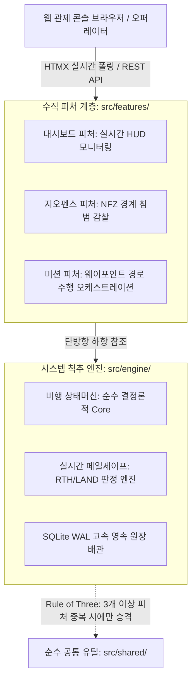

# DRONE-GCS: Multi-UAV Realtime Web-GCS

> 글로벌 드론 통신 표준(MAVLink/PX4) 기반 엔터프라이즈급 실시간 지상 관제 플랫폼 (Web-GCS)

---

## 1. 프로젝트 비전 및 개요

DRONE-GCS는 다수의 자율비행 무인기(군집 드론)를 중앙 관제 센터에서 실시간으로 모니터링하고 임무를 하달할 수 있는 웹 기반 지상 관제 시스템(Web-GCS)입니다.

과거 조종사가 현장에서 1:1로 노트북 프로그램을 실행하던 C++ 데스크톱 방식의 한계를 극복하고, 현대적 비동기 웹 스택(FastAPI + HTMX)과 엄격한 3계층 아키텍처를 결합하여 설치 없이 브라우저에서 다중 드론의 텔레메트리, 지오펜스(NFZ) 감찰, 웨이포인트 비행 미션을 초저지연으로 관제합니다.

---

## 2. 핵심 아키텍처 (Three-Tier Architecture)

본 시스템은 시스템 척추의 무결성과 피처 간의 독립성을 보장하기 위해 단방향 하향 의존성(Unidirectional Dependency)을 강제하는 3계층 구조를 채택하고 있습니다.



### 아키텍처 설계 헌법
1. **시스템 척추 엔진 (src/engine/)**: 시스템 핵심 헌법(비행 상태머신, 페일세이프 평가기, DB 원장)을 100% 통제하는 단일 진실 공급원(SSOT)입니다.
2. **수직 독립 피처 (src/features/)**: 각 업무(대시보드, 지오펜스, 미션)는 독립된 폴더 단위로 완결되며 피처 간 상호 직접 참조는 원천 차단됩니다.
3. **Shared-Nothing & Rule of Three (무공유 원칙)**: 무분별한 조기 공통화를 차단하기 위해 `src/shared/`는 사전에 비워두며, 최소 3개 이상의 피처에서 동일 유틸리티 중복이 실측될 때만 승격합니다.
4. **FCIS (Functional Core, Imperative Shell)**: 핵심 비행 상태 전이 및 기하학적 지오펜스 판정은 외부 I/O가 0건인 100% 순수 함수(Pure Core)로 격리됩니다.

---

## 3. 기술 스택 (Modern Tech Stack)

- **백엔드**: Python 3.11+ / FastAPI (비동기 asyncio 이벤트 루프)
- **프론트엔드**: Jinja2 + HTMX (자바스크립트 0줄 실시간 동적 대시보드)
- **스타일링**: Tailwind CSS (SF 텍티컬 HUD 글래스모피즘)
- **패키지 매니저**: Astral uv (PEP 621 pyproject.toml, uv.lock)
- **데이터베이스**: SQLite (WAL 모드, PRAGMA foreign_keys=ON)
- **테스트**: Pytest (77개 핀-테스트 100% 통과)

---

## 4. 핵심 기능 쇼케이스

- **다중 드론 실시간 HUD 관제 콘솔**: 배터리, 고도, 속도, 비행상태 100ms 무중단 HTMX 스트리밍
- **지오펜스(Geo-Fence) & 비행 금지 구역(NFZ) 감찰**: 0.001초 순수 기하 판정 및 자동 비상 RTH 전이
- **웨이포인트(Waypoint) 비행 미션 오케스트레이션**: 선행 상태 검증 및 다중 경로 주행 실시간 기록
- **자율 비행 안전망 페일세이프**: 3초 이상 통신 두절(LOST) 감지 및 저전압 자동 착륙

---

## 5. 초고속 실행 가이드 (Quick Start)

```bash
# 1. 저장소 복제 및 의존성 동기화 (0.5초 컷)
git clone https://github.com/eggpine84-del/38_drone_gcs.git
cd 38_drone_gcs
uv sync

# 2. 로컬 관제 웹 서버 기동
uv run main.py

# 3. 전체 핀-테스트 무결성 검증 (77 Passed)
uv run pytest -q
```

---

## 6. 디렉토리 구조 (Repository Layout)

```
38_drone_gcs/
├── pyproject.toml              # [PEP 621 현대적 패키지 명세]
├── uv.lock                     # [결정론적 의존성 동결 잠금 파일]
├── main.py                     # [애플리케이션 오케스트레이터 및 기동 엔트리포인트]
├── vercel.json                 # [클라우드 서버리스 배포 규격]
│
├── static/                     # [전역 정적 자산]
│   └── images/drone_gcs_hero.jpg
│
├── src/                        # [애플리케이션 소스 코드]
│   ├── engine/                 # [시스템 척추 엔진: 단일 진실 공급원 (SSOT)]
│   │   ├── core/               # 비행 상태머신, 페일세이프 평가기 (Pure Core)
│   │   └── shell/              # SQLite DB 어댑터, 텔레메트리/페일세이프 서비스 및 라우트
│   │
│   ├── features/               # [수직 비즈니스 도메인: 독립 완결 슬라이스]
│   │   ├── dashboard/          # 실시간 관제 대시보드 UI & 텔레메트리 렌더링
│   │   ├── geofence/           # 지오펜스(NFZ) 경계 판정 및 위반 방어
│   │   └── mission/            # 웨이포인트 비행 미션 명령 오케스트레이션
│   │
│   └── templates/base.html     # [전역 관제 베이스 레이아웃]
│
└── tests/                      # [77개 정예 핀-테스트 스위트]
    ├── conftest.py             # SQLite 인메모리 샌드박스 격리 픽스처
    ├── test_core/              # 상태머신 단위 테스트
    ├── test_features/          # 각 수직 피처별 Core / Shell 테스트
    └── test_shell/             # 아키텍처 헌법 가드, DTO 계약 가드, UI 마크업 가드
```

